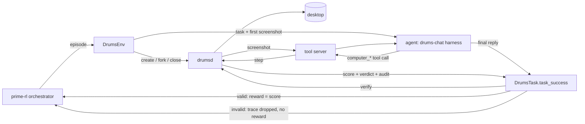

<p align="center">
  <a href="https://drums.run">
    <picture>
      <source media="(prefers-color-scheme: dark)" srcset="https://raw.githubusercontent.com/Drums-Labs/drums-verifiers/main/docs/assets/drums-symbol-light.svg">
      
    </picture>
  </a>
</p>

<h1 align="center">drums-verifiers</h1>

<p align="center">
  Drums environments for the <a href="https://github.com/PrimeIntellect-ai/verifiers">verifiers</a> library and
  <a href="https://github.com/PrimeIntellect-ai/prime-rl">prime-rl</a>: isolated desktops, OSWorld tasks and audited rewards for computer-use RL.
</p>

<p align="center">
  <a href="LICENSE"></a>
  <a href="https://github.com/Drums-Labs/drums-verifiers/actions/workflows/ci.yml"></a>
  <a href="https://docs.drums.run"></a>
  
</p>

<p align="center">
  <a href="https://drums.run">Website</a> ·
  <a href="https://docs.drums.run">Docs</a> ·
  <a href="https://bench.drums.run">Benchmarks</a> ·
  <a href="https://console.drums.run">Console</a>
</p>

---

## What it is

Drums runs many isolated Linux desktops from one running operating system: a host daemon, drumsd, restores a
checkpointed desktop per environment, forks a running environment into copies of the same state, and resets it in
milliseconds instead of booting a VM. This package connects that runtime to the verifiers v1 API, so prime-rl (and,
through adapters, verl and SkyRL) can run computer-use rollouts on it.

One rollout is one Drums environment running one task. The model acts through `computer_*` tools and gets a
screenshot back after every action. The reward is the task's own checker, run by drumsd outside the desktop, returned
together with the episode's validity verdict and a reward audit. A reward that cannot be trusted never reaches the
trainer as a reward.

The repository has three parts:

| Part | Package | What it does |
|---|---|---|
| The environment | `drums_verifiers`, `drums_chat` | `DrumsTaskset` and `DrumsEnv` for verifiers and prime-rl: OSWorld tasks, the `computer_*` tool server, fork groups for GRPO, the drop rules for invalid episodes, and a chat harness with a visual-context window |
| The task factory | `drums_tasks` | Seeded, parametrized tasks across LibreOffice Calc, Writer and Impress, Chrome, GIMP, VS Code, files and multi-app workflows, each with a programmatic checker, a redundant checker, a scripted solution and near-miss solutions, plus the validator that proves every task on a live host |
| Trainer adapters | `drums_adapters` | A verl tool and agent loop, and a SkyRL environment, one desktop per trajectory |

## Quickstart

### Install

Python 3.11 or later. The package pulls `verifiers` (0.4.1 or later, the version prime-rl requires) and the Drums SDK
(`drums-sdk`, import name `drums`) from PyPI.

```bash
python3 -m venv .venv && . .venv/bin/activate
pip install "drums-verifiers[test]"
```

To work from a checkout instead: `pip install -e ".[test]"` in the repository.

Extras: `test` (pytest), `verl`, `skyrl`, and `factory` (the task generator's pins; it needs its own venv, see
[Development](#development)).

### Run a rollout without a Drums host

The test suite ships a fake drumsd (`tests/fake_drumsd.py`) and a scripted stand-in for the model
(`examples/mock_policy.py`), so the whole path (verifiers, the environment, the tool server, the SDK) runs on a laptop.
From a clone of this repository, in the venv above:

```bash
echo t0k > /tmp/drums-token
python tests/fake_drumsd.py 7070 t0k &
python examples/mock_policy.py --port 8011 &
```

```bash
export DRUMS_URL=http://127.0.0.1:7070
export DRUMS_TOKEN_FILE=/tmp/drums-token
export DRUMS_RECORD=/tmp/drums-records.jsonl
export MOCK_KEY=x
vf-run drums-verifiers -m mock -n 1 -r 2 --client.base-url http://127.0.0.1:8011/v1 --client.api-key-var MOCK_KEY
```

Two rollouts run (one probe, one scripted solve), and `DRUMS_RECORD` gets one line per scored trace:

<details>
<summary>Output</summary>

```text
env       drums-verifiers  ·  drums-chat harness  ·  subprocess runtime
model     mock  via http://127.0.0.1:8011/v1
━━━━━━━━━━━━━━━━━━━━━━━━━━━━━━━━━━━━━━━━━━━━━ 2/2 · 10s · reward 0.50 · err 0.00
rewards   task_success 0.50
metrics   drums_valid 1.00  ·  drums_actions 4.00
╭ [success ] task name=e0df059f agent=agent · 3fd18077 · subp… reward=0.00 ·  8s
╰ [success ] task name=e0df059f agent=agent · 6c14bc89 · subp… reward=1.00 · 10s
```

```json
{"env": "s102", "valid": true, "verdict": "valid", "score": 0.0, "reward": 0.0, "dropped": null, "trusted": null, "turns": 5}
{"env": "s101", "valid": true, "verdict": "valid", "score": 1.0, "reward": 1.0, "dropped": null, "trusted": null, "turns": 7}
```

(records trimmed to the fields that matter; `trusted` is `null` because the fake drumsd sends no audit)
</details>

### Run against a Drums host

Needs a Drums host: a drumsd (v0.2.0 or later) that the env workers can reach, a tunnel is fine. The token is the
host's `/etc/drums/token`, or an API key from the [console](https://console.drums.run) for a hosted Drums.

```bash
export DRUMS_URL=http://127.0.0.1:7070
export DRUMS_TOKEN_FILE=/etc/drums/token
```

Then the same `vf-run` command with a real model endpoint that serves tool calls (`-m` and `--client.base-url`), or
prime-rl:

```toml
[[orchestrator.train.source]]
name = "drums"
env.taskset.id = "drums-verifiers"
env.taskset.task_ids = ["e0df059f-28a6-4169-924f-b9623e7184cc"]   # OSWorld ids, served by drumsd's pinned checkout
env.agent.max_turns = 15
# optional: GRPO from one reached state. One episode = one parent env, `prefix`, then N forked children
env.fork_n = 8
env.prefix = ["pyautogui.click(960, 540)"]
```

With `fork_n = N`, the N child traces of an episode form the comparison group: use `group_size = 1` with `grpo`. With
`fork_n = 0` (the default) use `group_size` as usual. A complete config is in
[examples/rl-drums-fork.toml](examples/rl-drums-fork.toml); `uv run rl @ examples/rl-drums-fork.toml --dry-run`
validates it on any machine.

### Train on your own GPUs

[docs/train-on-your-gpus.md](docs/train-on-your-gpus.md) runs full-parameter GRPO with prime-rl on GPUs you control,
with Drums serving the desktops. It covers two setups with one config file (`templates/rl-config.toml`) and one runner:
your own Modal account (`templates/modal/`) or any 8-GPU Linux machine (`templates/gpu-box/`). The recipe is our D1
run's (Qwen3.5-27B, 8 GPUs, 128 desktops). The guide gives the costs and step times that run measured, the pitfalls it
hit, and how to size a task pool so GRPO keeps learning.

## How it works



1. `DrumsEnv.run` creates the environment with the task (drumsd runs the task's own setup), waits until every gate of
   the episode has passed, and opens the conversation with the instruction and the first screenshot. With `fork_n`,
   it plays `prefix` on the parent, lets the desktop settle, forks N children and runs one agent per child.
2. The agent acts through MCP tools (`tools.py`). Each tool is one action in the desktop, a pause, and a screenshot.
   Three tool styles: `drums` (one tool per action, pixel coordinates), `scalecua` (the ScaleCUA agent's single
   `computer` tool and prompt, for ScaleCUA checkpoints) and `hybrid` (the GUI tools plus shell, file and app tools on
   the same desktop).
3. `DrumsTask.task_success` calls `env.verify()`: drumsd runs the task's checker outside the desktop and returns the
   score, the gate verdict and the reward audit. The environment is closed after scoring, and fork states are deleted.

## Task format

A task is an OSWorld task JSON: `id`, `instruction`, `config` (setup steps drumsd runs before the episode) and an
`evaluator`. OSWorld's own tasks are served by id from drumsd's pinned OSWorld checkout (`task_ids`), or read from a
directory of `<id>.json` files (`tasks_dir`).

The task factory (`drums_tasks`) generates tasks in the same format with a `drums_verifier` evaluator: a function in
the lab verifier `drums_t6.py`, its options, a redundant checker, and a scope manifest (the sha256 of every seeded file
under the task's roots, plus the globs the task is allowed to change). 40 families across seven apps; the default
build is 1,928 tasks with 5,437 near-miss solutions. Everything is a function of `(seed, family, index)`:

```bash
python -m drums_tasks.build --seed 1 --out /tmp/ts --check
```

writes `tasks.jsonl` (what an environment is created with; no solutions inside), `solutions.jsonl` (the scripted
oracle, the near misses and the scope probe of every task), `drums_t6.py` (installed as root into
`/etc/drums/verifiers/` on the host) and `index.json` (counts and the sha256 of each file). `--check` builds twice and
fails on any byte difference. Only `tasks.jsonl` and the verifier go to a host; the solutions are for the validator
(`python -m drums_tasks.validate`), which forks every task into no-op, oracle, near misses and scope probe on a live
host and accepts a task only when the checker separates them. The generator is deterministic, so anyone with the code
and a seed can rebuild a task set and its solutions; treat the seed of an evaluation set accordingly.

How to add a family: [CONTRIBUTING.md](CONTRIBUTING.md#add-a-task-family).

For a study that trains on some variants of one family and measures on others, `drums_tasks.split` builds a training
set and a held-out set of that family from two seeds and writes `pool.json` beside them (ids, params, both seeds, the
sha256 of each set); it fails when any held-out variant shares its instruction, a seeded file or its params with a
training variant:

```bash
python -m drums_tasks.split --family d1_calc_aggregate --train-seed A --heldout-seed B --train 64 --heldout 32 --out /tmp/pool
```

## Verifier contract

The reward never reaches the trainer without its verdict:

| What happened | Trace | prime-rl |
|---|---|---|
| Every gate passed, the checker ran | `reward = score` (0 or 1) | trained |
| A gate failed (isolation, mounts, network, cgroup limits, state hash, processes alive after restore), at the start or mid-episode (drumsd quarantines the environment) | no reward; `dropped = "drums_invalid:<verdict>:<gates>"` | skipped by `iter_trainable_traces`, left out of eval means |
| The checker failed, or drumsd or the desktop failed mid-episode | error (`ok = False`) | skipped |

Every scored trace carries `trace.info["drums"]`: environment and fork parent, verdict and failed gates, score,
checker error, action counts, and the reward audit drumsd attached:

- `trusted` is `True` only for a valid episode with a score and no audit flag. An older drumsd sends no audit, so
  `trusted` is `None` (unknown), never `True` by default. The metric `drums_reward_trusted` is recorded when it is known.
- `audit_flags` name what went wrong: `nondeterministic` (the same checker gave another answer on a recheck),
  `redundant_disagree` (the task's independent second checker disagreed), `scope_violation` (a file outside the
  task's allowed globs changed), `checker_crash`, `checker_timeout`, `scope_unchecked`.
- Redundant checkers: every factory task names a second checker (`check_alt`) that reads the same state through a
  different route and parser (the desktop's own tools instead of the file API; raw OOXML instead of openpyxl,
  python-docx and python-pptx; PyMuPDF instead of pypdf). drumsd runs both and compares them.

The audit never changes `score` or `valid`; this package drops invalid episodes and leaves the use of `trusted` and
the flags to the trainer. `DRUMS_RECORD=path.jsonl` writes one line per scored trace (environment, parent, verdict,
failed gates, score, reward handed out, audit flags, `trusted`, drop reason, timings) for offline audit.

## Vendored code: SCALE-CUA

`src/drums_verifiers/scalecua.py` carries the ScaleCUA OSWorld agent format (system prompt, the single `computer`
tool, tool call to pyautogui), copied from
[THUDM/SCALE-CUA](https://github.com/THUDM/SCALE-CUA) at commit `3929e2fe` (`osworld_eval/mm_agents/scalecua-osworld/utils.py`
and `main.py`), Apache License 2.0, Copyright the SCALE-CUA authors. One modification, recorded in the file as section
4(b) of the licence requires: the system prompt no longer gives the model the image's sudo password. In a Drums
environment the desktop user has no privilege escalation and an agent is never handed a credential.

## Development

```bash
python3 -m venv .venv && . .venv/bin/activate
pip install -e '.[test]'
ruff check .
python -m pytest tests
```

`pytest tests` runs the unit tests and an end-to-end `vf-run` run against the fake drumsd and the mock policy: single
environments, fork groups, invalid children that are dropped, a mid-episode environment failure, the reuse guard,
quarantine. Nothing in `tests/` talks to a real drumsd. CI ([ci.yml](.github/workflows/ci.yml)) runs exactly these
three commands on Ubuntu with Python 3.11 and 3.12.

The task factory's generator pins `pillow==11.0.0` (drumsd's checker venv), which conflicts with prime-rl's renderers,
so it lives in its own venv; the factory tests also need the checker venv's parsers:

```bash
python3 -m venv .venv-factory
.venv-factory/bin/pip install -r t6/requirements-factory.txt pymupdf==1.28.2 pypdf==6.20.1 pandas==2.2.3 pytest pytest-asyncio
.venv-factory/bin/pip install -e . --no-deps
.venv-factory/bin/python -m pytest tests/test_factory.py
```

Validation on a live host (`drums_tasks.validate`), the acceptance run on a fresh host with a real model
(`acceptance/`), the replication pipeline (`t6/`) and the GPU setup for prime-rl (`gpu/`) need a Drums host; their
scripts document their own inputs.

## Benchmarks

Measurements of Drums against other runtimes, with their conditions (paired or unpaired, replicated or not, scripted
policy or model), are at [bench.drums.run](https://bench.drums.run). This repository makes no performance claim of its
own.

## Security

Report vulnerabilities through GitHub's private vulnerability reporting, see [SECURITY.md](SECURITY.md). The
environment never puts the drumsd URL or token into task data or traces; the token comes from `DRUMS_TOKEN_FILE`
(default `/etc/drums/token`) or `DRUMS_TOKEN`. What the desktop isolates and what it does not is documented in
SECURITY.md and in the [docs](https://docs.drums.run).

## Contributing

[CONTRIBUTING.md](CONTRIBUTING.md): set-up, tests, how to add a task family, and what a pull request needs (a
Developer Certificate of Origin sign-off, tests, a validation run for a new family). Code of conduct:
[CODE_OF_CONDUCT.md](CODE_OF_CONDUCT.md).

## Licence

Apache License 2.0, see [LICENSE](LICENSE). `src/drums_verifiers/scalecua.py` is derived from Apache-2.0 code of the
SCALE-CUA authors, as described above.

## Status

Beta. Tested against verifiers `60290d43` (the commit prime-rl `a566e5d8` pins), drumsd v0.2.0 and drums-sdk 0.2.5.

- Stable: the taskset and environment configuration, the drop rules, the record format, the three tool styles.
- Working, may change: the task factory's families and checker kinds (`GENERATOR_VERSION` changes when a build's bytes
  change), the verl and SkyRL adapters.
- Not verified: running this package through the Drums Cloud gateway rather than against a drumsd host directly.
