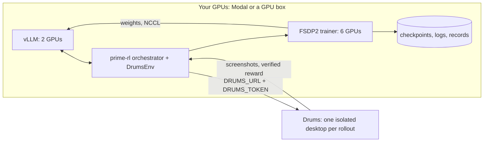

# Train on your own GPUs with Drums desktops

This guide runs reinforcement learning on a computer-use model with GPUs you pay for and control, and with
[Drums](https://drums.run) serving the desktops. There are two ways, and both use the same config file and the same
runner:

- **Your Modal account** (`templates/modal/`). Image, volumes, GPUs and the bill are all in your workspace.
- **Any 8-GPU Linux machine** (`templates/gpu-box/`): a cloud VM, a rented node or your own server, running the same image
  under Docker.

The recipe is the one from our first full training run (D1): Qwen3.5-27B, full-parameter GRPO with
[prime-rl](https://github.com/PrimeIntellect-ai/prime-rl), 8 GPUs, 128 desktops. D1 raised success on 32 held-out
variants of its task template from 0.54 to 1.00 (one template, one run; see
[the evidence](https://bench.drums.run/research/training-d1-november-2026)). This guide lists what it cost, what went wrong, and what to change.



## Files

| file | what it is |
|---|---|
| `templates/rl-config.toml` | **the one file you edit**: model, GPU type and split, Drums secret, task set, budget, prices, image pins |
| `templates/common/prime-rl-drums.toml` | the prime-rl recipe (validated on D1 settings; the throughput settings are to be validated on D2) |
| `templates/common/eval.toml`, `eval-inference.toml` | offline evaluation and the step-0 scan (standalone vLLM + `uv run eval`) |
| `templates/common/Dockerfile` | the image: CUDA 13.0.1, prime-rl at a pinned commit with its GPU extras, drums-verifiers, drums-sdk |
| `templates/common/drums_rl.py` | the runner (standard library only): download, check, scan, smoke, train, evaluate, export, spend, pool report |
| `templates/modal/app.py` | the Modal app: volumes, a Secret, GPU fallback lists, a start deadline, retries that resume |
| `templates/gpu-box/run.sh` | the same runner under `docker run --gpus all` |

## Before you start

1. **A Drums API key** from the [console](https://console.drums.run), with scopes `computers:read`, `computers:write`,
   `runs:read`, `usage:read`. Your workspace must allow as many live desktops as `[tasks] desktops` (128 in the
   recipe), and its spend cap must cover the run. D1's cap refused every create 24 minutes in, because the meter
   values each desktop-hour at the host price.
2. **A task set** with a training split and a held-out split, each a directory with a `tasks.jsonl`:
   `python -m drums_tasks.split` writes both, plus `pool.json` and an overlap check. Validate the tasks on Drums first
   (`python -m drums_tasks.validate`, which reads `DRUMS_TOKEN`). Size the pool with the section
   [The pool decides how long the run learns](#the-pool-decides-how-long-the-run-learns). This matters more than any
   GPU setting.
3. **A budget.** Put it in `[budget] usd` and `hours`. The train function stops itself there (see
   [Budget](#budget-and-stopping)).

## Run it on Modal

Everything below runs in your Modal workspace. You need `pip install modal` (1.6 or newer) and `modal token new` once.
Run all commands from the repository root.

```bash
# 1. the Secret: DRUMS_URL and DRUMS_TOKEN as environment variables of every GPU container.
#    Type the key in a shell you trust, or use --from-dotenv with a file you delete afterwards.
modal secret create drums DRUMS_URL=https://<your Drums gateway URL> DRUMS_TOKEN=<your API key>

# 2. edit templates/rl-config.toml ([tasks] train / heldout point at your split directories)

# 3. upload the task set to the runs volume (creates the volumes; the first command also builds the image:
#    30 to 60 min of CPU, about 1 to 3 USD)
modal run templates/modal/app.py::prepare

# 4. the pinned weights into the weights volume (CPU; 27B is 56 GB, 20 to 40 min)
modal run templates/modal/app.py::download

# 5. cheap checks: imports, Drums health, `rl --dry-run` of the rendered recipe (CPU, cents)
modal run templates/modal/app.py::check

# 6. the step-0 scan: the untrained model on the training tasks, K = 2, and the pool report (2 GPUs)
modal run --detach templates/modal/app.py::launch --what scan
modal volume get drums-rl-runs /eval/scan-step0/result.json .

# 7. the smoke: one optimizer step end to end (8 GPUs, about 20 min)
modal run --detach templates/modal/app.py::launch --what smoke

# 8. the run (resumes on retry, stops itself at the budget)
modal run --detach templates/modal/app.py::launch --what train
modal app logs drums-rl                        # follow it
modal run templates/modal/app.py::spend        # GPU spend so far, from the ledger

# 9. after the stop: export the last complete checkpoint, then evaluate step 0 and the trained model on held-out tasks
modal run templates/modal/app.py::export
modal run templates/modal/app.py::evaluate --model base --split heldout --k 6 --tag step0-heldout
modal run templates/modal/app.py::evaluate --model /runs/exports/train/step_<N> --split heldout --k 6 --tag last-heldout
modal volume get drums-rl-runs /eval ./eval
```

`launch` spawns the function and waits until a container has really started. If none has started after
`[gpus] start_deadline_min` (20 by default), it cancels the call, and you have paid nothing for GPUs. With `--detach`
the run keeps going after the command returns.

Per-episode records (with the action transcript and per-turn token counts) are in
`drums-rl-runs:/train/drums-record.jsonl`. The prime-rl logs are in `/train/logs`, and the metrics in
`/train/monitors/file/metrics.jsonl`.

## Run it on any 8-GPU Linux machine

You need Docker with the NVIDIA container toolkit (`docker run --rm --gpus all nvidia/cuda:13.0.1-base-ubuntu24.04
nvidia-smi` works), python3 3.11 or newer on the host, and about 1 TB of disk under `$DRUMS_RL_HOME` (default
`/data/drums-rl`) for a 27B run. GPUs must support CUDA 13. D1 ran on H200 and B200; prime-rl picks FA3 on Hopper and
FA4 on Blackwell by itself.

```bash
export DRUMS_URL=https://<your Drums gateway URL>
export DRUMS_TOKEN=<your API key>        # passed to the container by name; never written to a file or a command line
export DRUMS_RL_HOME=/data/drums-rl

templates/gpu-box/run.sh build           # the image (30 to 60 min)
templates/gpu-box/run.sh prepare         # copies [tasks] train / heldout into $DRUMS_RL_HOME/runs/tasks
templates/gpu-box/run.sh download
templates/gpu-box/run.sh check
templates/gpu-box/run.sh scan
templates/gpu-box/run.sh smoke
tmux new -s train 'templates/gpu-box/run.sh train'   # restarts up to 2 times on a crash, resuming each time
templates/gpu-box/run.sh spend
templates/gpu-box/run.sh export
templates/gpu-box/run.sh evaluate --model base --split heldout --k 6 --tag step0-heldout
templates/gpu-box/run.sh evaluate --model /runs/exports/train/step_<N> --split heldout --k 6 --tag last-heldout
```

On a box, `[prices] box_usd_per_hour` is what the machine costs you. Set it to 0 if only the hours limit should apply.

## The config

`templates/rl-config.toml` is commented key by key. The keys that decide the run:

| key | D1 value | notes |
|---|---|---|
| `[model] repo`, `revision` | `Qwen/Qwen3.5-27B`, `fc05dae...` | pin a commit; the download writes `refs/main` for it |
| `[gpus] modal` | `["H200:8", "B200:8"]` | Modal tries them in order; put the type you can get first |
| `[gpus] inference`, `trainer` | 2, 6 | 27B full parameter fits 6 trainer GPUs (peak 77 to 104 GiB per GPU on H200) |
| `[gpus] region` | `""` | a pin multiplies the whole container price: `us` 1.15x, `us-east` 1.75x |
| `[tasks] desktops` | 128 | episodes in flight at most; the recipe's in-flight floor is 3/4 of it |
| `[run] ckpt_interval` | 1 | one full checkpoint per step; see [Checkpoints](#checkpoints-cost-time-and-disk) |
| `[budget] usd`, `hours` | 500, 8 | the train function stops at either |
| `[image] prime_rl_commit` | `167d4c3` | prime-rl is not on PyPI; changing it means recomputing three versions in the Dockerfile |

## The prime-rl recipe (validated on D1 settings; throughput settings to be validated on D2)

`templates/common/prime-rl-drums.toml` is D1's training config with the run-specific values turned into placeholders.
What was validated by running it for 8 hours:

- **Loss.** prime-rl's own GRPO advantages with the IPO probability band, `[trainer.loss] type = "ipo"`, `eps = 0.3`.
  prime-rl has **no reference-KL term** for GRPO and **no PPO ratio clip**. A "KL 1e-4, clip 0.2 / 0.28" setting
  from another trainer has no equivalent here, so do not look for one.
- AdamW, lr 3e-6 constant, grad clip 1.0, fp32 master weights and reduction, full activation checkpointing,
  `offload = "none"`, frozen vision tower.
- Group size 8, batch 128 (16 groups per step), `max_staleness = 8`, temperature 0.8, 1,536 completion tokens,
  15 turns, thinking off (`enable_thinking = false`; with thinking on, Qwen3.5 spends the completion budget before
  it acts).
- vLLM bf16, tensor parallel 2, prefix caching on, `mm_processor_cache_gb = 32`, parsers `qwen3_coder` / `qwen3`.
- 1280x720 observations, the `drums` tool style, one desktop per rollout (`fork_n = 0`).

What is new and **not yet validated on GPUs** (marked `[D2]` in the file):

- the screenshot window `screenshots_full = 3`, `screenshots_total = 6`, `downscale = 0.5`, `screenshots_stride = 3`
  (D1 sent the newest 5 at full size and moved the window every turn);
- `min_inflight` raised from 8 to 3/4 of the desktops (96 of 128).

To run exactly D1's settings, replace the four window lines with `env.agent.harness.images_to_keep = 5` and set
`min_inflight = 8`. The window keys need drums-verifiers 0.3.0 (proposed, not on PyPI yet). `[image] drums_verifiers`
is a placeholder, `drums-verifiers @ git+https://github.com/Drums-Labs/drums-verifiers@PIN_A_COMMIT`: replace
`PIN_A_COMMIT` with the full 40-character sha of the commit you run (for D2, the merge commit of the post-D1
integration on `main`), or with `drums-verifiers==0.3.0` once it is released. `run.sh build`, the Modal app and `check`
refuse the placeholder and `@main`, so a study never trains on whatever `main` is that day; the image build prints the
installed version. `DRUMS_RL_ALLOW_UNPINNED=1` lets an unpinned spec through for a deliberate try.

All four rendered files (train, smoke, eval, inference) pass prime-rl 167d4c3's `--dry-run`, and the resolved env config
shows the window keys. Note that prime-rl also accepts `env.agent.harness` keys the installed drums-verifiers does not
know, **without a warning**: with 0.2.2 the dry run passes and the run would quietly use the old window. So `check`,
`smoke`, `train` and `evaluate` validate the harness settings against the installed `DrumsChatConfig` first, and refuse
unknown keys.

## Rollout throughput: what D1's logs say and what to change

D1's last 400 vLLM log samples:

| measure | value |
|---|---|
| prompt (prefill) throughput | 8,617 tokens/s (median) |
| generation throughput | 411 tokens/s, so prefill is about 20x decode |
| prefix cache hit rate | 64% (36% of prompt tokens recomputed on every turn) |
| requests running / waiting | median 12 / 0 |
| KV cache used | about 2% |
| episodes in flight (prime-rl's controller) | 36 to 80 of 128 allowed |

So the inference GPUs were **not** full. The idle desktops came from two places: the controller kept few episodes in
flight, and every turn re-read about five full-size screenshots. Do not add inference GPUs. Change these instead, in
this order:

1. **A higher in-flight floor** (`[orchestrator.concurrency] min_inflight`). With 0 requests waiting there is room.
2. **Fewer, smaller screenshots in context.** A 1280x720 screenshot is about 900 vision tokens. At `downscale = 0.5` it
   is about a quarter of that (estimate).
3. **A prompt layout that keeps the cached prefix stable.** The 0.2.2 window removes one older screenshot on every turn,
   so each request differs from the previous one a few messages before the end, and everything after that point is
   prefilled again. `screenshots_stride = s` moves the window on one turn in s; on the other turns the request is the
   previous one plus the new messages, byte for byte (unit-tested in `tests/test_window.py`). The system prompt, task
   text and first screenshot never change.
4. **FP8 inference weights**: the next lever after these, not tried yet.

Rough arithmetic for the `[D2]` setting (estimate, to be measured): about 3 full and 3 downscaled screenshots in
context, about 4,300 vision tokens against D1's 4,500. The prefill per turn falls from about one window's worth to
about one new screenshot on two turns of three.

What to watch on D2:

- vLLM's prefix-cache hit rate and its prompt and generation throughput (its periodic log lines);
- `turn_tokens` in the record (`cached_tokens / prompt_tokens` per turn, when the server reports cached tokens);
- episodes in flight against `[tasks] desktops`;
- the batch wall time per step.

## The pool decides how long the run learns

D1 trained on 64 variants of one template. The untrained model solved 0.63 of them at step 0 (27 of 64 mixed). By
step 5 the policy solved almost every training group:

| step | batch reward | episodes for 128 trainable samples | share discarded as zero-advantage |
|---|---|---|---|
| 4 | 0.844 | 312 | 59% |
| 5 | 0.859 | 1,936 | 93% |
| 6 | 0.875 | 7,872 | 98% |

GRPO learns only from groups whose rollouts disagree. A group of 8 that all succeed (or all fail) has zero advantage,
and prime-rl discards it. With a zero-advantage share z, one optimizer step needs about `batch / (1 - z)` episodes
(128 / 0.016 = 8,000 at step 6). So the run spent its last 3.6 hours on one step. **A 64-variant template is too small a
pool for 8 hours of full-parameter training.**

**Read the zero-advantage share** two ways:

- prime-rl's orchestrator log counts, for every step, the episodes it discarded with no signal. Divide by the episodes
  it finished.
- From the record file, while the run is going:

  ```bash
  python3 templates/common/drums_rl.py pool-report drums-record.jsonl --group-size 8 --last 512
  ```

  This prints, per task and pooled, the success rate of the last N episodes. It also prints
  `expected_zero_advantage_share`, the mean over tasks of `p^G + (1 - p)^G` (the chance that a group of G is all
  successes or all failures). The step-0 scan prints the same report for the untrained model.

**Size the pool** (rules of thumb from one run, not validated):

- **Start hard.** Pick tasks whose step-0 rate is mostly between 0.1 and 0.5. At p = 0.3 a group of 8 is all-same
  6% of the time; at p = 0.9 it is 43%, and at 0.97, 78%. D1 started at 0.63, with 26 of 64 variants already at 1.0.
  Tasks at 0 are no better: at p = 0 nothing is learned, so include easier tiers too.
- **Enough variants that each one is seen only a few times.** A step uses 16 groups, so S steps draw 16 x S variants.
  Aim for at most two or three draws per variant over the planned steps, for example 200 or more variants for 30 steps.
  Several templates and apps beat more variants of one.
- **Watch the share, and act at about 0.5.** At z = 0.5 a step costs twice the episodes. Past it, swap in harder
  tasks, turn on prime-rl's `difficulty_pool` curriculum (untested with Drums), or stop: the run has learned what this
  pool can teach.

## Budget and stopping

Every GPU function writes a heartbeat to `<runs>/spend.jsonl` once a minute: what it is, the GPU type and count, and
the hourly price from `[prices]` times the region factor. `spend` prints the totals. The train function checks the
ledger every minute. When the **total** across scan, smoke, train and evaluations reaches `[budget] usd`, or the train
attempts' own wall clock reaches `[budget] hours`, it stops prime-rl (SIGTERM, then SIGKILL after 120 s) and writes
`<run>/STOPPED`. It then exits normally, so Modal does not retry it. The last complete checkpoint is the result:
`export` picks it by default. A train launch over budget refuses to start. Evaluations still run after a budget stop,
and they count toward the total.

The ledger is an estimate from list prices. Your Modal invoice (or your provider's) is the record.

## What D1 measured

Modal list prices on 2026-11-16, no region pin: H200 4.54 USD/GPU-hour, B200 6.25, CPU 0.0473 per core-hour, memory
0.008 per GiB-hour, volumes 0.09 per GiB-month. An 8 x H200 container with 32 cores and 256 GiB costs 39.88 USD/h; 8 x
B200 costs 53.56 USD/h. Dollar figures below are estimates from GPU-hours and timestamps.

| phase | measured | cost |
|---|---|---|
| image build | CPU, 30 to 60 min | about 1 to 3 USD |
| weights | 56 GB into a volume | about 1 USD + 5 USD/month storage |
| step-0 scan (2 x H200) | 384 episodes at 48 in flight, about 34 min, 7 to 11 min per template | about 5.5 USD |
| smoke (8 x H200) | `rl` 1,060 s: vLLM ready after 5 min, 8 rollouts, 1 step, checkpoint 5 min; peak 77.4 GiB per trainer GPU | about 11.5 USD |
| training step, H200 | 10 to 12 min compute + about 7 min checkpoint; 6,450 to 8,100 tokens/s; MFU 18 to 20% | about 13 USD per step |
| training step, B200 | about 14 min with checkpoint; 11,600 to 18,100 tokens/s; MFU 14 to 22% | |
| whole D1 | 8 h trained, 6 steps, about 9,000 rollouts, 84 GPU-hours on Modal in all | about 504 USD with the desktop host |
| evaluation (2 GPUs) | 192 episodes at 48 in flight in 6 to 13 min | a few USD each |
| export to HF (CPU) | 7.5 min | under 1 USD |

## Pitfalls D1 hit

- **`refs/main` and pinned revisions.** `snapshot_download(repo, revision=<commit>)` does not write
  `refs/main`. With `HF_HUB_OFFLINE=1`, vLLM's lookup of the bare repo name then fails with `LocalEntryNotFoundError`,
  although every weight file is there. `drums_rl.py download` writes `refs/main`. In your own recipe, either do the
  same or pass the revision to vLLM.
- **uv's `exclude-newer`.** prime-rl's `pyproject.toml` sets `exclude-newer = "7 days"`, and uv applies it
  to `uv pip install` run inside the prime-rl directory. A drums-verifiers release younger than a week is then rejected.
  Install from outside the project directory with `--no-deps`, as the Dockerfile does. Run everything with
  `uv run --no-sync`: a plain `uv run` re-syncs the venv to prime-rl's lock and removes drums-verifiers.
- **Modal capacity.** The scan waited 3 h 07 min for 2 x B200 without getting a container; 8 x H200 alone got
  none in 25 minutes. `2 x H200` came within a minute. Use fallback lists (`[gpus] modal`, `modal_eval`), launch with
  the start deadline, and record which GPU actually ran (the first lines of every function print `nvidia-smi`).
  A region pin narrows capacity and raises the price.
- **Preemption and the resume trap.** Modal preempted the 8 x B200 container 43 min into an attempt and
  restarted it on 8 x H200. The preemption landed between the orchestrator's save and the trainer's save, so `step_3`
  held only the orchestrator's progress. prime-rl's `--resume` picks the newest step directory by name, loaded the
  partial one, and failed. `drums_rl.py train` moves every step directory without `trainer/.metadata` to
  `checkpoints-partial/` before it resumes. They are kept, never deleted. The loss was about 4 minutes of compute
  plus about 8 minutes to load the model again.
- **Checkpoints cost time and disk.** A 27B full-parameter DCP checkpoint (fp32 weights + AdamW state) is about 333 GB
  and took about 7 minutes per step to write on Modal: about a third of a trainer step. `keep_last = 2` holds about
  666 GB (about 60 USD/month on a Modal volume until you delete it). `[run] ckpt_interval = 2` halves the write time and
  doubles what a preemption can cost. Do not download checkpoints: export the one you need (HF bf16, 56 GB).
- **The two evaluation paths.** Training renders prompts with prime-rl's renderer, and evaluation uses the model's
  chat template over chat completions. Compare step 0 and the trained model on the same path, as the templates do.
- **Unknown harness keys are ignored silently.** See the recipe section: `drums_rl.py` checks them before every run.
- **The desktops' side.** Check your workspace's live-desktop quota and spend cap before a 128-desktop run. A refused
  create is an errored episode, not a reward.
